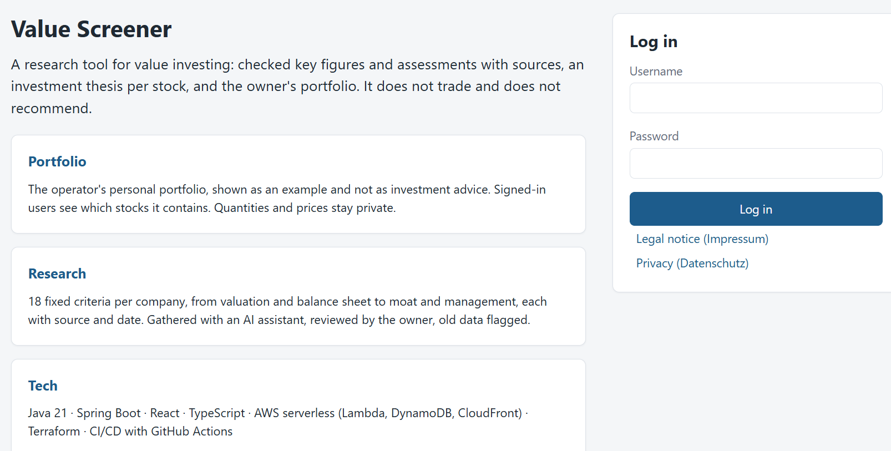
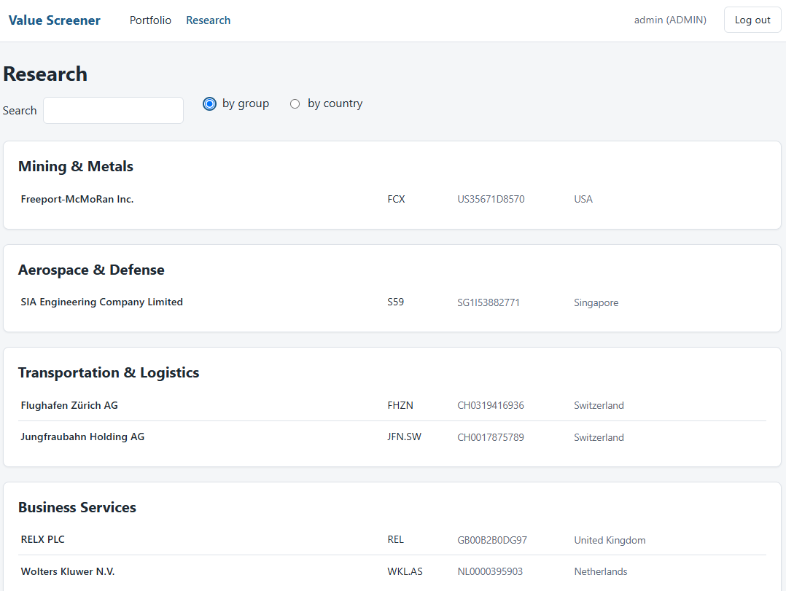
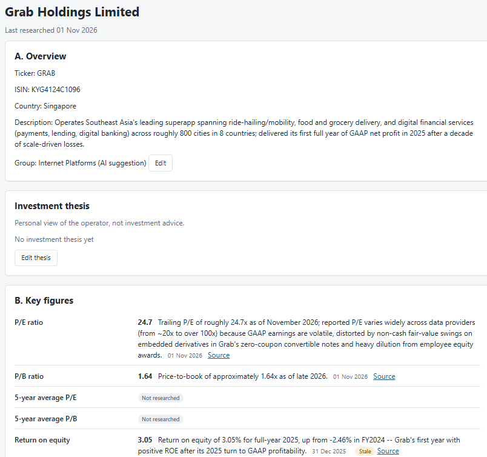
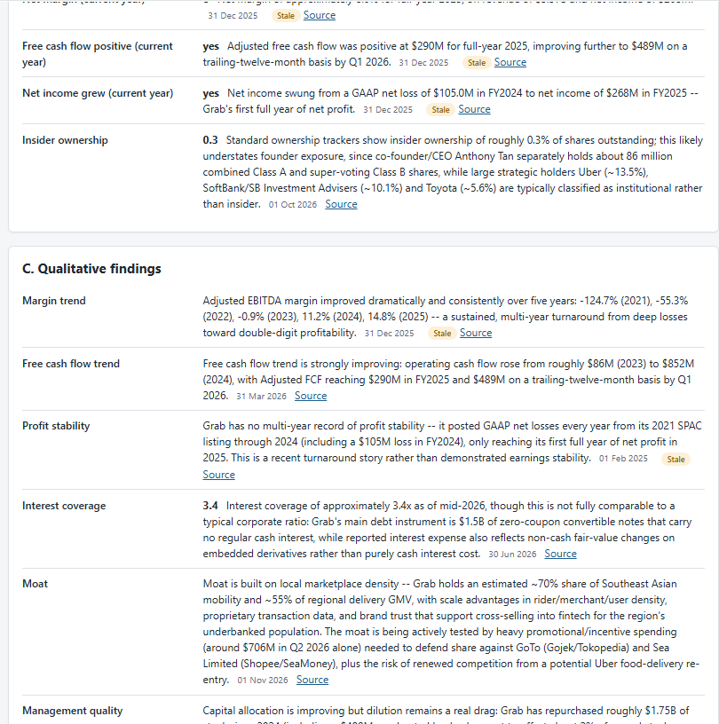
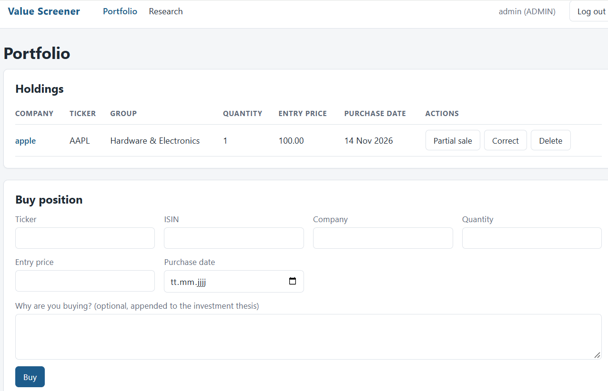
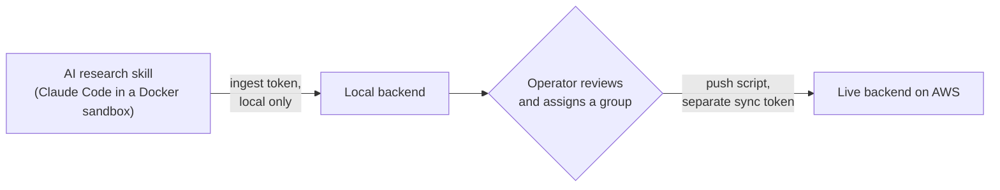
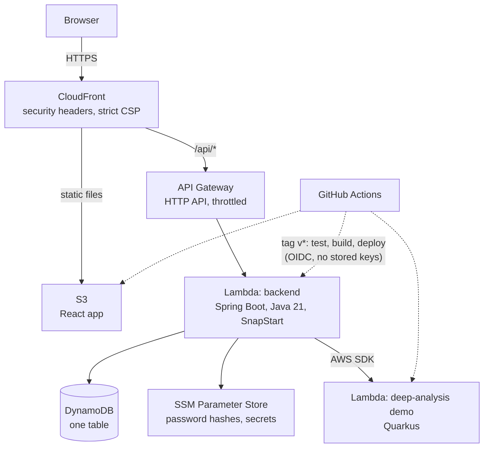
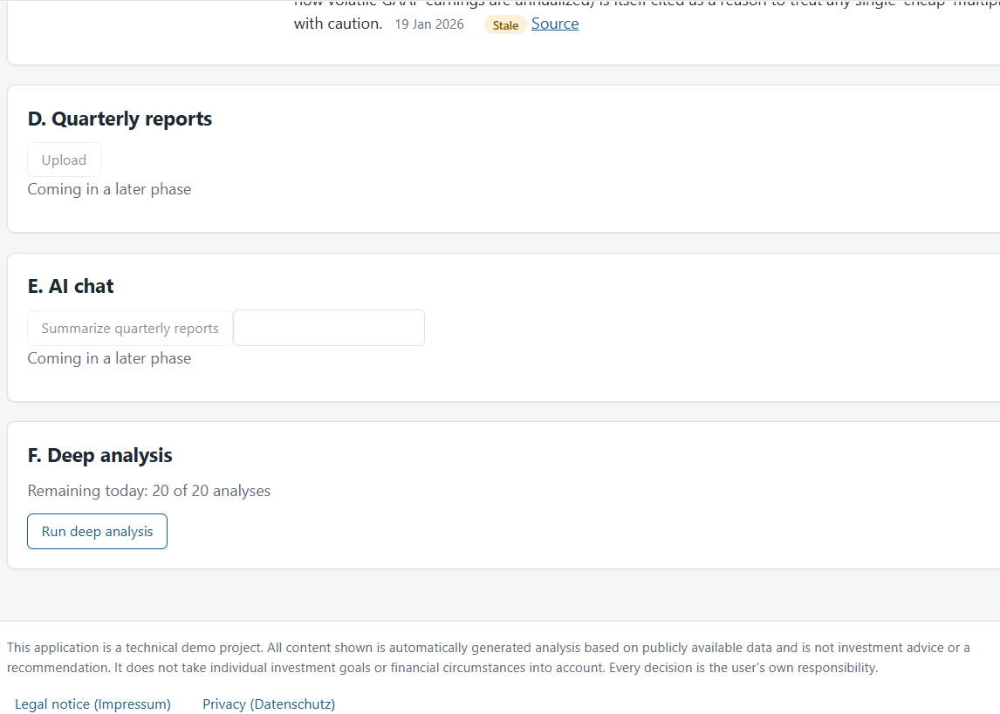

# Value Screener

[](https://github.com/BenjaminS01/value-screener/actions/workflows/ci.yml)

**A research tool for value investing, built as a showcase for Java, AWS serverless, Terraform and AI-assisted
research.** For each company it shows checked key figures and assessments, each with source and date. It keeps an
investment thesis per stock and the operator's personal portfolio, shown as an example. It **does not trade and does
not recommend**: it describes, people decide.

The project has two purposes:

1. **Showcase:** clean Java/Spring Boot backend, React frontend, AWS serverless infrastructure fully in Terraform,
   CI/CD, security-conscious design, and a practical vehicle for the AWS Developer certification.
2. **Personal tool** of the operator for stock analysis.

The whole app is login-only. Accounts are handed out personally, there is no self-registration.



---

## What it does

**Research overview**, grouped by sector group or by country:



**Company detail** with overview, investment thesis and key figures:



**Every figure and assessment** with its as-of date, a "Stale" badge when it is old, and a source link:



### Research

Every researched company can be opened, grouped by sector group or by country and searchable by name, ticker or
ISIN.

- **Overview:** name, ticker, ISIN, country, group and business description.
- **18 fixed criteria**, always in the same order so companies are comparable:
  - *Key figures:* P/E and P/B (current and 5-year average), return on equity, net margin, free cash flow
    positive, net income grew, debt to equity, current ratio, insider ownership.
  - *Qualitative findings:* margin trend, free cash flow trend, profit stability, interest coverage, moat,
    management quality, value trap assessment (a stock that only looks cheap because the business is in trouble).
- **Every figure has a source link and an as-of date.** Missing criteria show as "Not researched", so gaps stay
  visible.
- **Data age:** findings older than a configurable threshold are marked "Stale", and each company shows when it was
  last researched.
- **History:** a new research run never silently overwrites old values. Earlier values can be expanded per
  criterion, e.g. how the P/E changed.
- **Conflict of interest:** if the operator holds the stock, the page says so clearly.

### Investment thesis

Value investing means writing down *why* you hold a stock and *what* would make you sell. Per stock the operator
records why it is interesting, the expected development, the exit criteria and a status (Watching / Rejected).
"Holding" is derived from the portfolio, so it can never contradict the real holdings. Everyone signed in can read
the thesis, only the operator edits it, and it always carries the note *"Personal view of the operator, not
investment advice."*

### Portfolio

The operator's personal portfolio, shown as an example. The operator can buy, sell partially, correct and delete
positions. Other users only see *which* stocks are held: quantities, prices and dates are never sent to their
browser.



### Groups

A maintained list of sector groups (banks, insurance, semiconductors, software, ...). The AI suggests a group during
research, the operator can change it, and a group set by hand is never overwritten by a later research run.

### Deep analysis (placeholder)

A button that calls a separate small Lambda function and shows its runtime metadata. It proves the wiring
(backend → AWS SDK → Lambda, with daily limits per account). Later this becomes the in-app research that replaces
today's local research skill.

### Roles

| | ADMIN (operator, one account) | USER (a few personal accounts) |
|---|---|---|
| See which stocks are held | ✅ with quantity, price, date | ✅ company, ticker, group only |
| Edit the portfolio | ✅ | ❌ |
| Read research, history and thesis | ✅ | ✅ |
| Change groups, edit the thesis | ✅ | ❌ |
| Deep-analysis button | ✅ | ✅ with own daily limit |

Every permission is enforced in the backend. A hidden or disabled button in the frontend is only a hint, never the
protection.

### Deliberately not included

No trading, no broker connection, no buy or sell recommendations, no automatic market screening, no public view,
no self-registration.

---

## How research data gets in

**Interim solution:** for now, a local research skill is used to generate sample data. Later the research data will
come from the deep analysis planned inside the application.

Research runs **locally**, never in AWS. An AI assistant (a Claude Code skill) searches the web inside an isolated
Docker sandbox and fills the 18 criteria with sources. The operator reviews the result, and only then a script on the
operator's machine pushes the reviewed snapshot to the live system.



Why it is built this way:

- **Web content is untrusted.** A web page can contain text that looks like an instruction to the model (indirect
  prompt injection). So the skill runs in a sandbox that mounts only this repository read-only and gets a token
  that can do exactly one thing: write a snapshot to the *local* backend. That endpoint does not exist in AWS.
- **A human checks every result** before it goes live.

---

## Architecture

Serverless on AWS (`eu-central-1`), built entirely with Terraform:



Why this shape:

- **Almost nothing to pay while idle.** No servers, no VPC, no NAT gateway. DynamoDB stays inside the free tier,
  Lambdas cost only per call. A small monthly budget with alerts and an automatic deny action is the safety net.
- **One origin for everything.** CloudFront serves the frontend and `/api/*`, so there is no CORS. The API cannot
  be called directly, only through CloudFront.
- **Data is separate from the app.** Table and secrets live in their own Terraform stack. Tearing down the app
  stack deletes no data.
- **Cold starts are acceptable:** SnapStart keeps the Spring Boot Lambda start short, at no extra cost.
- **Deploys only via version tag.** A `v*` tag runs all tests, builds both Lambdas, publishes new versions and
  switches the `live` alias. If a step fails, `live` stays on the old version.

| Terraform stack | Holds |
|---|---|
| `infra/bootstrap` | state bucket |
| `infra/foundation` | artifact bucket, GitHub OIDC, deploy role, budget with deny action |
| `infra/data` | DynamoDB table (protected against deletion), SSM secrets |
| `infra/app` | both Lambdas, HTTP API, frontend bucket, CloudFront |

More detail: [`docs/aws/aws-architecture-overview.md`](docs/aws/aws-architecture-overview.md).

### Tech stack

| Area | Technology |
|---|---|
| Backend | Java 21, Spring Boot 3, Spring Security, Spring Session, AWS SDK v2 (DynamoDB enhanced client) |
| Deep-analysis Lambda | Java 21, Quarkus |
| Frontend | React 18, TypeScript, Vite, Vitest + Testing Library |
| Infrastructure | Terraform, AWS Lambda, API Gateway, DynamoDB, S3, CloudFront, SSM, IAM/OIDC, Budgets |
| CI/CD | GitHub Actions (tests on every push, deploy on version tag) |
| Research | Claude Code skill in a Docker sandbox |

---

## Security

The login page is public, so the app protects itself without paid services:

- **Session login** with an `HttpOnly`, `Secure`, `SameSite=Strict` cookie, a new session id after login, and CSRF
  protection for every changing request. Sessions live in DynamoDB, so they work across Lambda instances.
- **Brute-force protection:** login attempts are rate-limited per IP with growing delays, and an account is locked
  temporarily after repeated failures. The answer is the same whether a user exists, is locked or typed a wrong
  password, so neither text nor timing gives anything away.
- **Least privilege by default:** write endpoints require the ADMIN role unless explicitly opened, so a forgotten
  endpoint is closed, not open. USER views structurally do not contain private fields.
- **No secrets in the repo, in Terraform state or on the command line.** Only bcrypt and SHA-256 hashes are stored,
  in SSM. CI deploys with short-lived OIDC credentials instead of access keys.
- **Edge hardening:** HSTS, a strict Content Security Policy, no framing, and the API only reachable through
  CloudFront.

---

## Built and roadmap

| Part | Status |
|---|---|
| Login with roles, brute-force protection | ✅ live |
| Portfolio (role-dependent) | ✅ live |
| Research with 18 criteria, data age, history, groups | ✅ live |
| Investment thesis | ✅ live |
| Deep-analysis placeholder via Lambda, daily limits | ✅ live |
| Serverless AWS with Terraform, deploy via tag, research sync | ✅ live |
| Quarterly reports (PDF upload) and AI chat with page citations | ⏳ planned, design done |
| AI evaluation of quarterly reports against the thesis | ⏳ planned |
| Deep analysis in the app (replaces the local research skill) | ⏳ later |

The detail page already reserves the places for these features:



Design documents: [`docs/superpowers/specs/`](docs/superpowers/specs/). Running status:
[`PROJECT-STATUS.md`](PROJECT-STATUS.md).

## Learning notes

The project is also a learning project. [`docs/learning/`](docs/learning/) holds short write-ups of real bugs and
decisions from this codebase, e.g. prompt injection, verifying API claims with `javap`, cross-checking LLM
citations, config precedence gotchas and AI cost control.

---

# Development

## Prerequisites

Java 21, Maven, Node 20, Docker (for DynamoDB Local and the research sandbox).

## Run locally

```bash
cp .env.example .env      # then fill in the hashes, see below
./dev-up.sh               # DynamoDB Local, backend (profile local) and frontend
```

Frontend: http://localhost:5173 (proxies `/api` to the backend on http://localhost:8080).

Or start the parts by hand:

```bash
docker compose up -d dynamodb-local        # port 8000, data in a Docker volume
cd backend && mvn spring-boot:run          # needs ADMIN_USERNAME and ADMIN_PASSWORD_HASH
cd frontend && npm install && npm run dev
```

The backend uses DynamoDB Local through `APP_DYNAMODB_ENDPOINT=http://localhost:8000` and
`APP_DYNAMODB_CREATE_TABLE=true` (set by `dev-up.sh`). `APP_DYNAMODB_TABLE_NAME` changes the table name.

## Tests

```bash
cd backend && mvn test
cd frontend && npm test
cd deep-analysis && mvn test
```

CI runs all three on every push and pull request.

## Accounts

### Admin password hash

```bash
cd backend
mvn -q spring-boot:run \
  -Dspring-boot.run.main-class=com.valuescreener.security.auth.AdminPasswordHashGenerator
```

The password is asked for hidden (twice) and never passed as an argument, so it does not end up in shell history
or `ps`. Do not redirect or pipe the output, otherwise there is no console and the input becomes visible.

Put the hash into `.env` **in single quotes**, because `dev-up.sh` sources the file and the shell would expand `$`:

```bash
ADMIN_PASSWORD_HASH='$2a$10$...'
```

### More accounts (role USER)

```bash
export APP_USERS_0_USERNAME=alice
export APP_USERS_0_PASSWORD_HASH='<hash from AdminPasswordHashGenerator>'
```

Checked at startup (the app does not start on an error): usernames are case-insensitive, unique (also against
`ADMIN_USERNAME`) and not empty, `*` is reserved, and every hash must be a valid bcrypt hash. Use long random
passwords.

## Research sandbox

The `research-company` skill (`.claude/skills/research-company/`) lets Claude Code search the open web and store
the result. Untrusted web content plus real tool execution is a classic entry point for indirect prompt injection,
so the skill **must** run in the Docker sandbox (it aborts outside of it):

```bash
export RESEARCH_INGEST_TOKEN="$(grep '^RESEARCH_INGEST_TOKEN=' ~/.config/value-screener/live.env | cut -d= -f2-)"
./docker/claude-sandbox/run.sh
```

What the sandbox gets and what not:

- **No admin password.** Only the ingest token, which allows exactly one call on the *local* backend.
- **The repository is mounted read-only**, so a manipulated session cannot change scripts the operator runs later.
- **The ingest endpoint exists only with profile `local`**, otherwise the path answers `404`. It is never active
  in AWS.
- **The skill shows the full JSON before sending** and waits for an explicit OK.
- **`.env` is readable from the sandbox**, which is why it holds only hashes, never plain tokens or passwords.

Even if the prompt-injection mitigations fail, the damage is limited to writing single snapshots to the local
database.

### Create a machine token

Used for both the ingest token and the sync token (one run each):

```bash
cd backend
mvn -q spring-boot:run -Dspring-boot.run.main-class=com.valuescreener.security.machinetoken.MachineTokenGenerator
```

It prints `token=<...>` and `sha256=<...>`. The hash goes to the backend (`APP_RESEARCH_INGEST_TOKEN_HASH` in
`.env` for ingest, SSM for sync). The token goes into `~/.config/value-screener/live.env` (readable only by you),
never into `.env` or the repository. Tip: redirect the generator output into a file created with `umask 077`
instead of showing it.

### Research a company

1. Start the app with `./dev-up.sh` (terminal 1).
2. Start the sandbox as shown above (terminal 2). The first start asks once for a Claude Code login, kept in a
   Docker volume.
3. In the sandbox prompt: `research AAPL`. The skill researches, shows the JSON and stores it after your OK.
4. Check the result in the app under *Research* and assign a group.

### Push reviewed research to live

```bash
scripts/push-research.sh US0378331005
```

Runs on the host, never in the sandbox. It exports the snapshot from the local backend and sends it with the
separate sync token to the live backend. `~/.config/value-screener/live.env` holds `LIVE_BACKEND_URL`,
`RESEARCH_SYNC_TOKEN` and `RESEARCH_INGEST_TOKEN` (Unix line endings, readable only by you). The script refuses to
run if the file is missing, readable by others, has Windows line endings, or if sync and ingest token are the same.
It never prints tokens, only the ISIN and HTTP status.

- `409` on export: the snapshot has no group yet.
- `422` on import: the group does not exist live, create it there first.
- A group set by hand (`MANUAL`) is transferred and never overwritten live by an AI suggestion.

**Local end-to-end test with a second backend as "live":** start a second backend on port 8081 with its own table
and without profile `local`, then point `LIVE_BACKEND_URL` at it:

```bash
cd backend
APP_DYNAMODB_ENDPOINT=http://localhost:8000 APP_DYNAMODB_CREATE_TABLE=true \
APP_DYNAMODB_TABLE_NAME=value-screener-live SERVER_PORT=8081 \
APP_RESEARCH_SYNC_ENABLED=true APP_RESEARCH_SYNC_TOKEN_HASH=<sha256> \
mvn spring-boot:run
```

Expected from `scripts/push-research.sh <ISIN>`: two times `HTTP 200`.

## Build and deploy

The backend Lambda zip is built next to the normal jar:

```bash
cd backend && mvn -B package -DskipTests   # → target/value-screener-backend-lambda.zip
```

Code only goes live through a version tag, never by hand:

```bash
git switch main && git pull
git tag -a v3.3.0 -m "v3.3.0: <what changes>" && git push origin v3.3.0
```

`.github/workflows/deploy.yml` tests all three modules, uploads both Lambda zips, publishes new versions, switches
the `live` alias and syncs the frontend to S3 with a CloudFront invalidation. Configuration (environment variables,
permissions, API, CloudFront) is changed with Terraform in `infra/app` and takes effect with the next tag.

---

## Disclaimer

This is a technical demo project. All content is automatically generated analysis based on publicly available data
and is not investment advice or a recommendation.
